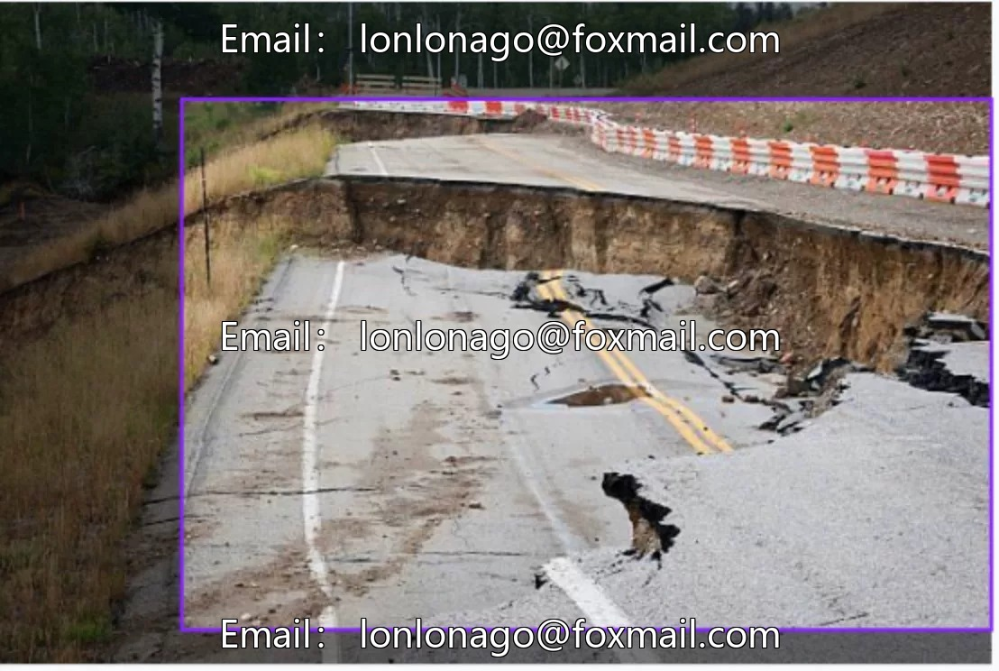
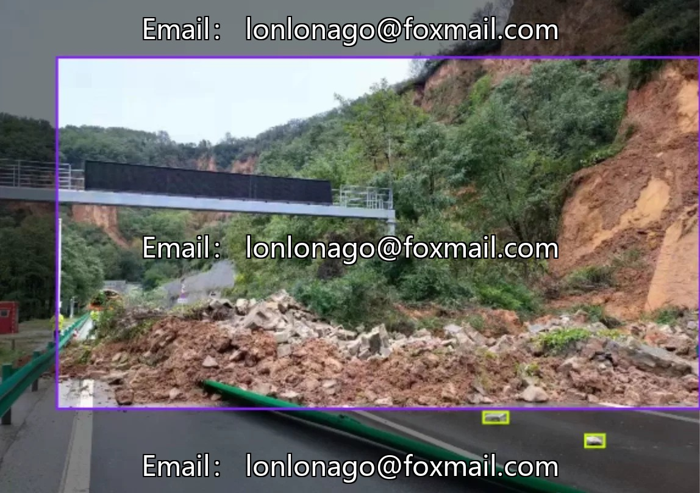
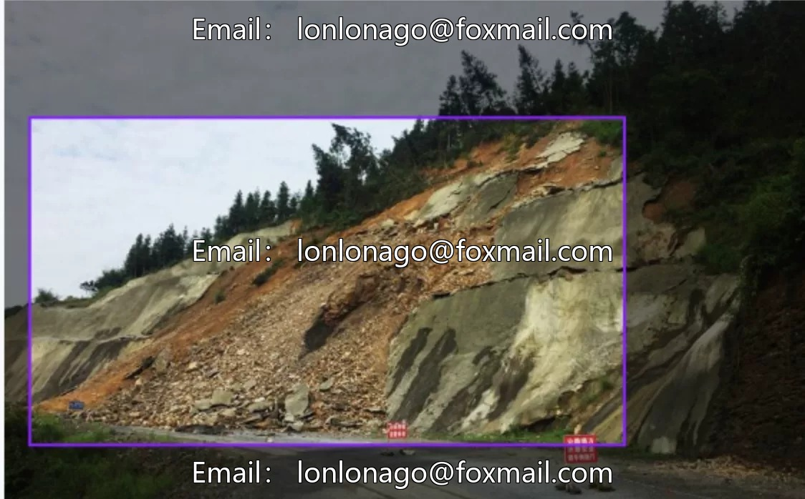
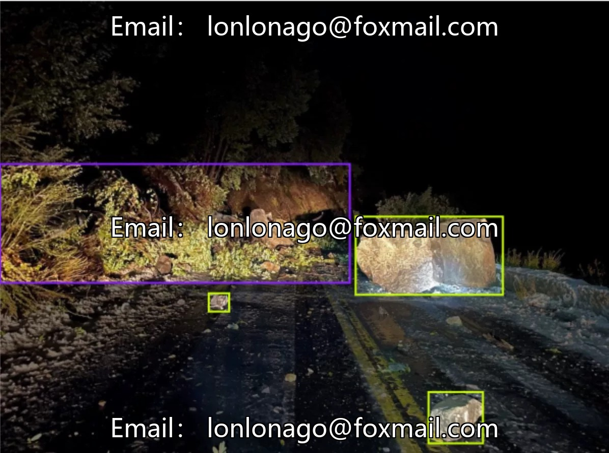
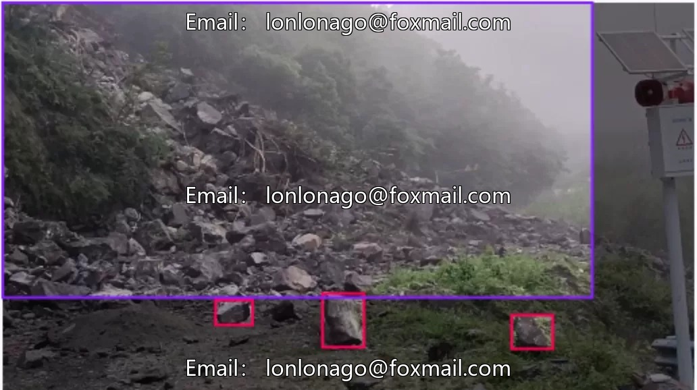
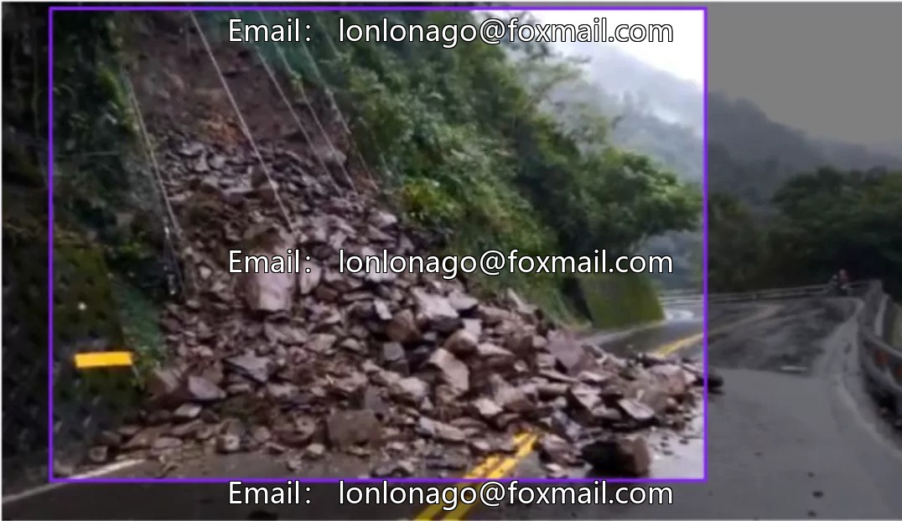

# Geological disaster intelligent detection dataset, roadside slope landslide dataset, highway rockfall dataset

## Body

Geological disaster intelligent detection dataset, roadside slope landslide dataset, highway rockfall dataset, drone aerial inspection patrol dataset, disaster early warning image dataset, issue 10184

The dataset consists of three categories: landslides, rockfalls, and tree falls, totaling 958 images. It is suitable for training target detection models and supports computer vision tasks.

The data format is an image file, currently there are no associated dataset files and models. It is suitable for training small to medium-sized models, which can be expanded in the future.

Virtual materials, once sold, are non-refundable.
Interested friends, click "I want" to proceed.

## Images

## Payment

Here is a pay link on Stripe ( https://buy.stripe.com/3cs8yP7sY87d0vu9AB ). Please contact me lonlonago@foxmail.com after funding $89, and I will send you a complete data files , thank you!

